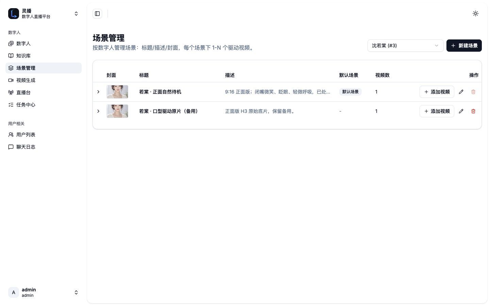
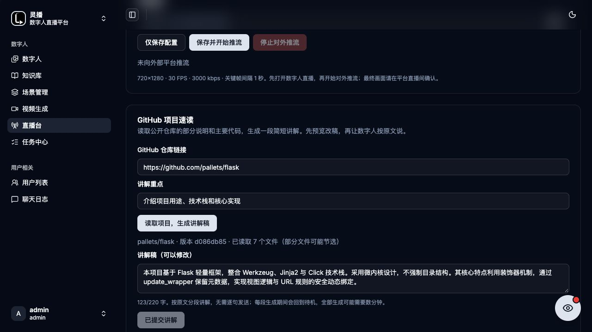

# 灵播 LingCast

<p align="center">
  
</p>

<p align="center"><a href="README.md">English</a> | <a href="README-zh.md">简体中文</a></p>

支持声音克隆、观众互动、自主主持和换装的数字人直播平台。

**Qwen 流式回复 → CosyVoice3 流式配音 → MuseTalk 1.5 逐帧口型 → FFmpeg / SRS 推流。**

[架构文档](docs/技术需求与架构文档.md) · [生产部署](docs/cosyvoice-musetalk-live.md) · [开发交接](AGENTS.md) · [文档站](https://taochangle.github.io/LingCast/)

## 能做什么

- **直播工作台**：管理数字人、素材和场景，监看竖屏直播，配置外部推流地址与密钥。
- **手动口播**：输入的文字就是数字人要说的话，原文插播，结束后回到当前造型待机。
- **观众互动**：Chrome 插件读取直播页面新增评论、进场、点赞和礼物提示，由服务端去重、限频并生成回复或感谢。
- **自主主持**：准备话术库或分段讲稿，暂停、继续、结束；手动口播和互动优先，讲完继续主持。
- **点播小节目**：笑话、夸夸、晚安三类固定稿，每类30条，按场次轮换减少重复。
- **项目速读**：读取公开 GitHub 项目资料，整理讲解内容，可作为口播或主持的参考。
- **换装**：已准备的沈若棠形象支持白衣、酒红裙、香槟套装轮换；播放完整告别、静音走位、回场语后恢复主持。
- **音视频缓存**：同一句话按人物、音色、模型和底片身份复用，主持话术可提前生成，减少重复计算。
- **知识与记录**：知识库检索、人物设定、聊天记录，以及独立观众端；第三方直播评论不维护按昵称识别的连续个人会话。

插件只读用户主动打开的页面DOM，不发送平台评论。仅采集页面实际展示的信息，不保证平台一定提供准确礼物名称或完整观众身份。

## 实际界面

以下为2026-10-30项目演示中的实际界面和换装视频抽帧，不代表今天服务器的即时状态。截图中的部分提示早于当前缓存准备及密钥生命周期调整，以本文和代码核对后的说明为准。


| 场景与驱动素材 | GitHub项目速读 |
| --- | --- |
|  |  |

<details>
<summary>沈若棠换装演示：酒红裙</summary>


</details>

素材出处和筛选说明见[截图记录](docs/images/current/README.md)。

## 当前技术栈

| 层 | 实现 |
| --- | --- |
| 管理端 | React 19、TypeScript、Vite 8、Tailwind CSS 4、shadcn/ui、TanStack Router / Query |
| 观众端 | 独立 Next.js 16 / React 19，xgplayer HTTP-FLV |
| API | Go 1.25、Gin、GORM、AWS S3 SDK v2；admin / live / telegram / web / scheduler 多入口 |
| 直播 Worker | 宿主机原生 Python、uv、Redis、boto3、FFmpeg |
| LLM | OpenAI兼容 Qwen Chat Completions SSE，按完整短句入队 |
| 配音与口型 | 常驻 CosyVoice3、MuseTalk 1.5，独立环境，Linux NVIDIA CUDA |
| 数据与存储 | MariaDB 11、Redis 8.2、RustFS（S3兼容） |
| 知识检索 | FastAPI、zvec全文索引、Jieba分词 |
| 直播与采集 | SRS v5、Nginx、Chrome MV3 插件 |

Worker项目允许 Python `>=3.11,<3.14`，`.python-version`固定为3.12。模型服务各用独立环境，不应向已有模型环境同步全部依赖组。前端使用 pnpm 10.25。

## 数据流与播放

```text
手动口播 ───────────────────────────────┐
Chrome DOM事件 → 采集API → 分类/去重/限频 ├→ Redis优先队列
观众提问 → Qwen SSE → 完整短句 ─────────┘
    → 直播Worker → CosyVoice3音频块 → MuseTalk口型帧
    → 配对PCM/JPEG → 常驻FFmpeg → SRS
    → HTTP-FLV监看 / 外部RTMP
```

手动口播不经LLM改写；自由评论回复使用Qwen，固定点播、感谢和欢迎走对应规则。播放优先级：

**手动口播 → 礼物感谢 → 点赞感谢 → 评论回复 → 欢迎 → 自主主持。**

当前短段讲完才取下一项，不硬打断正在说的话。CosyVoice与口型计算按音频窗口衔接，收到配对数据就播放，不等待完整MP4；完成后回到当前造型待机。已播出的句子无法在后续模型失败时撤回。

当前已准备知夏（ID2）与沈若棠（ID3）的口型profile。新增数字人或底片必须先完成匹配的预处理，不能直接套用其他人物的人脸数据。当前MuseTalk生产输出为25fps、16kHz单声道音频；底片规格及身份映射见[流式手册](docs/cosyvoice-musetalk-live.md)。

## 部署与本地开发

代码、依赖和编排文件不能替代模型权重、参考音频、人脸预处理缓存与私有配置。新机器不能只启动Compose就获得完整GPU直播能力。

1. 准备 Git、Docker Engine / Compose、Go 1.25、pnpm 10.25、Python / uv、FFmpeg，以及适配模型环境的 NVIDIA 驱动和CUDA。
2. 克隆仓库，复制环境模板并填写自己的配置。生产仅开放必要后台网关，队列、存储、SRS内部入口和模型均使用内网或loopback。
3. 按[流式生产手册](docs/cosyvoice-musetalk-live.md)准备独立模型环境、权重、参考声音与形象profile，检查健康及预热状态。
4. 启动基础设施、相关API与前端，再启动原生直播Worker；核对API和Worker版本、素材身份及服务地址。
5. 在Live Studio先验证待机、手动口播、播放结束和缓存复用，再按需开启插件互动与外部推流。

```sh
git clone https://github.com/taochangle/LingCast.git
cd LingCast
cp .env.example .env
cp worker/.env.local.example worker/.env.local
```

以上仅建立配置文件；模板包含其他工作流选项，需按当前流式手册选择填写。`deploy/chengdu.override.yml`展示内网/loopback隔离；主机目录、模型环境与服务单元须适配自己的环境。`deploy/chengdu.sh`是整体部署入口，**不要为文档、插件或素材更新无差别执行它**。

管理端本地开发（API及依赖需另行准备）：

```sh
cd frontend/admin
pnpm install
pnpm dev
```

观众端在`frontend/live/`执行相同命令。后端测试在`backend/`执行`go test ./...`；模型、素材或真实直播联调需要额外环境，不由单元测试代替。

## 配置与安全

| 配置 | 用途 |
| --- | --- |
| `LINGCAST_PUBLIC_ORIGIN` | 私有环境中配置后台访问源；插件打包时读取默认服务器，用户可编辑 |
| `OPENAI_API=chat_completions` | 选择Qwen兼容聊天接口 |
| `V2_QWEN_BASE_URL` / `V2_QWEN_MODEL` / `V2_QWEN_API_KEY` | Qwen服务地址、模型与认证 |
| `LIPSYNC_ENGINE=musetalk` | 选择当前直播口型引擎 |
| `COSYVOICE_URL` / `MUSETALK_RESIDENT_URL` | 内部常驻模型入口 |
| `MUSETALK_WARDROBE_URL` / `WARDROBE_MANIFEST` | 已准备的新造型服务与运行清单 |
| `S3_*` / `REDIS_*` | 素材存储与队列；按各进程配置格式填写 |
| `ADMIN_USERNAME` / `ADMIN_PASSWORD` | 管理员初始化配置；使用独立强密码 |

服务地址、凭据、外部推流密钥仅放私有配置。不要提交`.env`、打包后的插件ZIP、真实采集事件、运行日志、模型和媒体素材。插件采集凭据由后台按数字人生成，当前不自动过期，可重新生成或撤销；不存在共享默认采集密码。

观众输入经过提示词防注入和内容过滤，但这不是对所有输出的安全保证；手动口播按原文播放，需由操作者自行确认。[防注入说明](docs/live-prompt-guard.md)。

## 缓存、换装与发布边界

完整音视频事件保存在模型实例磁盘`production-cache/`，按人物、文字、底片及模型/参考声音指纹隔离。不完整输出不会成为可用缓存；容量淘汰或指纹改变会导致重新生成。服务重启不主动清空磁盘缓存，但Worker内存准备状态需要重建。

沈若棠两套新造型已完成各27条主持话术的预生成及复读命中验证。该记录不意味着所有新句都无需等待，也不保证未来缓存永不淘汰。生成耗时、Worker首帧、浏览器监看与平台延迟应分别测量，不宣称固定秒级开口。

换装必须等当前口播完成，依次播放旧造型告别 → 静音离场/空镜/新造型入场 → 切换新idle与renderer → 回场语 → 恢复互动与主持。更新底片需同时准备口型数据与缓存。当前Worker重建会短暂重连，不承诺无缝不停播热更。

文档更新仅同步文件；插件更新只打包相关产物；业务更新仅发布相关服务。模型重启需明确授权，不能为普通功能或素材更新重启模型。详见[换装与回退](docs/wardrobe.md)。

## 目录与文档

```text
backend/           Go API及测试
frontend/admin/    管理后台与Live Studio
frontend/live/     独立观众端
frontend/web/      一对一网站客户端
frontend/telegram/ Telegram Mini App
worker/            直播Worker、模型服务、缓存与播放管线
extensions/        Chrome采集插件及打包工具
services/          知识检索与其他辅助服务
deploy/            Compose覆盖、服务单元与部署脚本
docs/              架构、专项手册、历史说明
```

- [流式直播部署与排障](docs/cosyvoice-musetalk-live.md)
- [Chrome插件采集](docs/chrome-collector.md) · [感谢优先级](docs/thanks-priority.md)
- [自主主持](docs/autonomous-host.md) · [点播节目](docs/viewer-interaction.md)
- [换装与分造型缓存](docs/wardrobe.md)
- [旧引擎与旧启动流程归档](docs/history/legacy-readme-zh.md)

历史文档用于追溯其他管线，不作为当前生产默认配置或部署指令。
