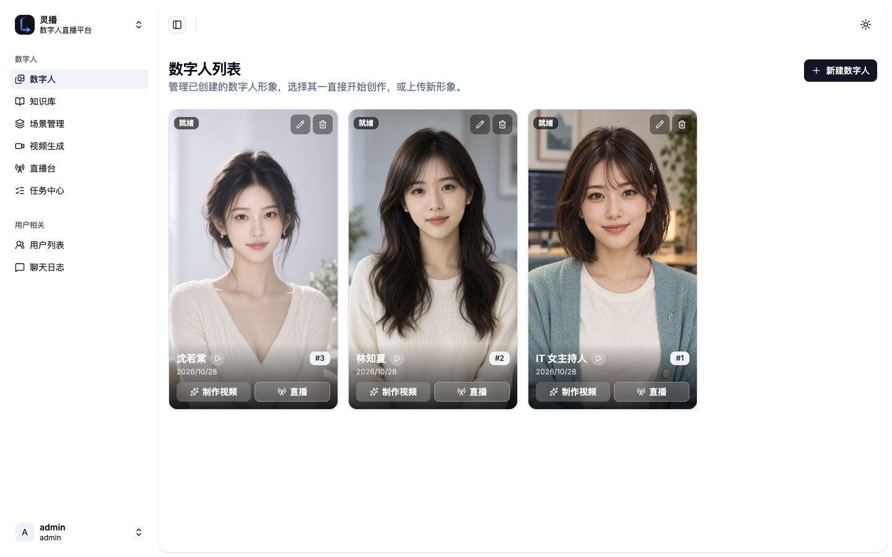
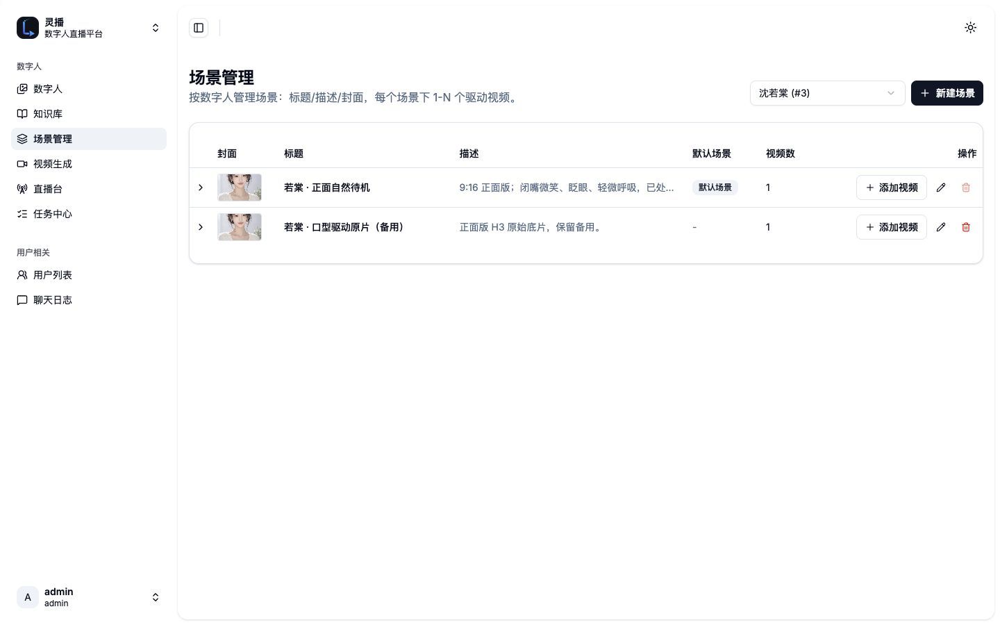
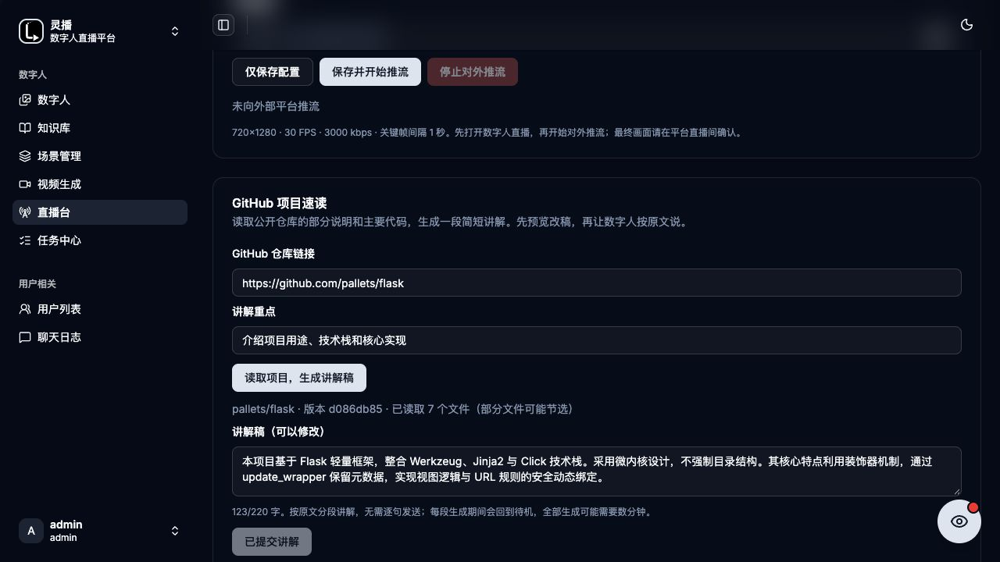

# LingCast

<p align="center">
  
</p>

<p align="center"><a href="README.md">English</a> | <a href="README-zh.md">简体中文</a></p>

AI digital-human live streaming with voice cloning, audience interaction, autonomous hosting and wardrobe changes.

**Qwen streaming replies → CosyVoice3 streaming speech → MuseTalk 1.5 lip-sync frames → FFmpeg / SRS streaming.**

[Architecture](docs/技术需求与架构文档.md) · [Production runbook](docs/cosyvoice-musetalk-live.md) · [Developer handoff](AGENTS.md) · [Documentation site](https://taochangle.github.io/LingCast/)

## Features

- **Live Studio:** manage avatars, scenes and media; monitor portrait video and configure external streaming destinations and keys.
- **Manual speech:** speak the supplied text verbatim, then return to the current outfit's idle video.
- **Audience interaction:** a Chrome extension reads new comments, arrivals, likes and gift notices; the server deduplicates, rate-limits and produces replies or acknowledgements.
- **Autonomous hosting:** prepare a script library or finite presentation; pause, resume and stop. Manual speech and interactions take priority, then hosting continues.
- **Viewer programmes:** jokes, compliments and goodnight messages, with 30 fixed scripts per category and session-based rotation to reduce repetition.
- **Project reading:** read public GitHub project material and prepare explanations for speech or hosting reference.
- **Wardrobe changes:** the prepared Ruotang avatar rotates through white, burgundy and champagne outfits using complete farewell, silent movement and return sequences.
- **Media caching:** reuse repeated lines by avatar, voice, model and source-video identity; pre-generate hosting scripts to reduce repeated computation.
- **Knowledge and records:** retrieval, persona settings, persisted chat and a separate viewer app. Third-party live comments do not maintain individual conversations keyed by nicknames.

The extension only reads the DOM of a page the user opens and explicitly starts collecting. It never posts platform comments. Collection is limited to information actually displayed; accurate gift names and complete viewer identities are not guaranteed.

## Screenshots

Actual interface images and a wardrobe demo frame from the 2026-10-30 project demonstration. These are recorded views, not evidence of today's running service state. Text within a screenshot may predate the current preparation or credential lifecycle; the code-backed documentation below takes precedence.



| Scenes and source videos | GitHub project reader |
| --- | --- |
|  |  |

<details>
<summary>Ruotang wardrobe demo: burgundy outfit</summary>


</details>

Image provenance and selection: [screenshot notes](docs/images/current/README.md).

## Current stack

| Layer | Implementation |
| --- | --- |
| Admin | React 19, TypeScript, Vite 8, Tailwind CSS 4, shadcn/ui, TanStack Router / Query |
| Viewer | Standalone Next.js 16 / React 19, xgplayer HTTP-FLV |
| API | Go 1.25, Gin, GORM, AWS S3 SDK v2; admin / live / telegram / web / scheduler entry points |
| Live Worker | Native host Python, uv, Redis, boto3, FFmpeg |
| LLM | OpenAI-compatible Qwen Chat Completions SSE, queued at complete sentence boundaries |
| Speech and lip-sync | Resident CosyVoice3 and MuseTalk 1.5 in separate environments, Linux NVIDIA CUDA |
| Data and storage | MariaDB 11, Redis 8.2, RustFS S3-compatible storage |
| Retrieval | FastAPI, zvec full-text index, Jieba tokenizer |
| Streaming and collection | SRS v5, Nginx, Chrome MV3 extension |

The Worker project supports Python `>=3.11,<3.14`; `.python-version` pins 3.12. Model services use separate environments. Do not sync every dependency group into an existing model environment. Frontends use pnpm 10.25.

## Pipeline and playback

```text
Manual speech ──────────────────────────────────────┐
Chrome DOM events → collector API → classify/limit ├→ Redis priority queues
Viewer question → Qwen SSE → complete sentences ────┘
    → live Worker → CosyVoice3 audio blocks → MuseTalk frames
    → paired PCM/JPEG → persistent FFmpeg → SRS
    → HTTP-FLV monitor / external RTMP
```

Manual speech bypasses the LLM. Free-form replies use Qwen; fixed programmes, acknowledgements and welcomes follow their own rules. Playback priority is:

**Manual speech → gift thanks → like thanks → comment replies → welcomes → autonomous hosting.**

The current short segment finishes before another task starts. Speech and lip-sync computation overlap through audio windows; paired data can play without waiting for a complete MP4. Playback returns to the current outfit's idle video when done. Already spoken sentences cannot be retracted if a later model request fails.

Prepared profiles currently cover Zhixia (ID2) and Ruotang (ID3). A new avatar or source video needs matching preprocessing; another person's face cache is never a fallback. The production MuseTalk output uses 25fps and 16kHz mono audio. See the [streaming runbook](docs/cosyvoice-musetalk-live.md) for source specifications and identity mapping.

## Deployment and local development

Source code and Compose files do not include model weights, reference audio, prepared face caches or private configuration. Starting Compose alone does not provide the complete GPU streaming pipeline.

1. Prepare Git, Docker Engine / Compose, Go 1.25, pnpm 10.25, Python / uv, FFmpeg, and NVIDIA drivers/CUDA appropriate for the separate model environments.
2. Clone the repository and populate private environment files. Publish only the necessary admin gateway; keep queues, storage, internal SRS endpoints and models on internal networks or loopback.
3. Follow the [production runbook](docs/cosyvoice-musetalk-live.md) to prepare model environments, weights, reference voices and avatar profiles; verify readiness and warmup.
4. Start infrastructure, relevant APIs and frontends, then the native live Worker. Verify API/Worker revisions, source identities and service configuration.
5. In Live Studio, verify idle playback, manual speech, completion and cache reuse before enabling collection or external streaming.

```sh
git clone https://github.com/taochangle/LingCast.git
cd LingCast
cp .env.example .env
cp worker/.env.local.example worker/.env.local
```

These commands only create configuration files. The templates contain options for other workflows; select settings using the streaming runbook. `deploy/chengdu.override.yml` demonstrates internal/loopback isolation; adapt host paths, model environments and service units to your own deployment. `deploy/chengdu.sh` is a full deployment entry point: **do not run it indiscriminately for documentation, extension or media-only updates**.

For local admin development, with the API and dependencies prepared separately:

```sh
cd frontend/admin
pnpm install
pnpm dev
```

Run the same commands in `frontend/live/` for the viewer app. Backend tests run with `go test ./...` from `backend/`. Model, media and actual streaming validation require additional environments and are not replaced by unit tests.

## Configuration and security

| Setting | Purpose |
| --- | --- |
| `LINGCAST_PUBLIC_ORIGIN` | Private admin origin; supplies the extension's editable default server during packaging |
| `OPENAI_API=chat_completions` | Select the Qwen-compatible chat API |
| `V2_QWEN_BASE_URL` / `V2_QWEN_MODEL` / `V2_QWEN_API_KEY` | Qwen endpoint, model and authentication |
| `LIPSYNC_ENGINE=musetalk` | Select the current live lip-sync engine |
| `COSYVOICE_URL` / `MUSETALK_RESIDENT_URL` | Internal resident model endpoints |
| `MUSETALK_WARDROBE_URL` / `WARDROBE_MANIFEST` | Prepared outfit renderer and runtime manifest |
| `S3_*` / `REDIS_*` | Media storage and queues; follow each process's configuration format |
| `ADMIN_USERNAME` / `ADMIN_PASSWORD` | Initial administrator configuration; use a unique strong password |

Keep deployment endpoints, credentials and external stream keys in private configuration. Do not commit `.env` files, packaged extension ZIPs, real collector events, runtime logs, model weights or media assets. The admin generates revocable collection credentials per avatar (no automatic expiry in the current implementation); they can be regenerated or revoked. There is no shared default collection password.

Audience input passes prompt-injection and content filters, but this is not a guarantee for every output. Manual speech is played verbatim and requires operator review. See [prompt guard](docs/live-prompt-guard.md).

## Caches, wardrobe and release boundaries

Complete audio/video events persist in each model instance's on-disk `production-cache/`, isolated by avatar, text, source video and model/reference-voice fingerprint. Incomplete output is not reusable. Capacity eviction or a changed fingerprint requires regeneration. Service restarts do not intentionally clear the disk cache, while the Worker's in-memory preparation state must be rebuilt.

Both new Ruotang outfits have completed pre-generation and repeat-hit verification for 27 hosting lines each. This is a release record, not a promise that every new sentence is instant or cached forever. Measure generation, Worker first-frame, browser buffering and platform delay separately; there is no fixed opening-latency guarantee.

Wardrobe playback waits for current speech to finish, then follows: old-look farewell → silent exit / empty scene / new-look entrance → commit new idle and renderer → return speech → resume interaction and hosting. New source videos require matching lip-sync data and caches. Rebuilding the current Worker briefly reconnects the stream; seamless uninterrupted hot reload is not guaranteed.

Documentation updates only synchronize files; extension updates package the relevant artifacts; application changes deploy only affected services. Model restarts require explicit authorization and are not part of routine feature or media updates. See [wardrobe and rollback](docs/wardrobe.md).

## Layout and documentation

```text
backend/           Go APIs and tests
frontend/admin/    Admin console and Live Studio
frontend/live/     Standalone viewer app
frontend/web/      One-to-one website client
frontend/telegram/ Telegram Mini App
worker/            Live Worker, model services, caches and playback
extensions/        Chrome DOM collector and packaging
services/          Retrieval and other supporting services
deploy/            Compose overrides, service units and deployment scripts
docs/              Architecture, runbooks and historical documentation
```

- [Streaming deployment and troubleshooting](docs/cosyvoice-musetalk-live.md)
- [Chrome collector](docs/chrome-collector.md) · [Acknowledgement priority](docs/thanks-priority.md)
- [Autonomous hosting](docs/autonomous-host.md) · [Viewer programmes](docs/viewer-interaction.md)
- [Wardrobe and appearance-specific caches](docs/wardrobe.md)
- [Archived engines and setup procedures](docs/history/legacy-readme-en.md)

Historical documents preserve other pipelines for reference; they are not current production defaults or deployment instructions.
