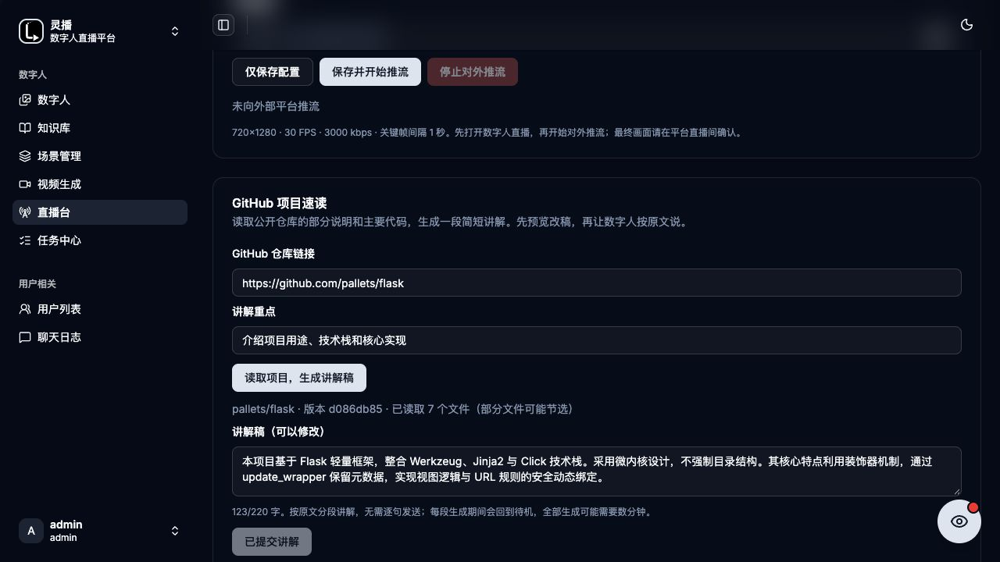

# GitHub项目速读

实现：`backend/internal/handlers/live/project.go`，`frontend/admin/src/features/live-studio/project-reader.tsx`。

管理员在Live Studio填写`https://github.com/作者/仓库`形式的公开仓库主页与讲解重点，通过`POST /api/projects/read`生成短稿。链接不接受分支/文件路径、查询参数、片段或用户认证部分。

先获取默认HEAD提交SHA，再读取该提交的递归目录；按说明/依赖/入口代码优先级挑选最多7个文件。超过150000字节的文件跳过，每份最多使用5500字符，截断会标注；目录过大或读取失败返回警告。只读GitHub API，不克隆执行仓库代码，不跟随资料中的操作指令。

Qwen据这些资料生成短口播，返回仓库、固定提交、来源列表和警告。讲稿限220字，过长会进行一次压缩；这不是全仓审计，也不保证覆盖核心调用链。预览/编辑不发声，操作者确认后才能提交。

`POST /api/live/:avatarID/narrate`需已开播，讲稿原文进入手动队列，以同一个narration任务保留顺序，队列满拒绝；当前流式模式按原文经CosyVoice/MuseTalk播放。也可导入自主主持参考资料，再生成并预览分段稿。资料中的任何指令不提升为操作者授权。

截图来自2026-10-30演示，底部旧生成时间文案不是当前性能承诺。不能将部分文件速读表述为执行了测试、完整分析或验证了项目运行结果。
